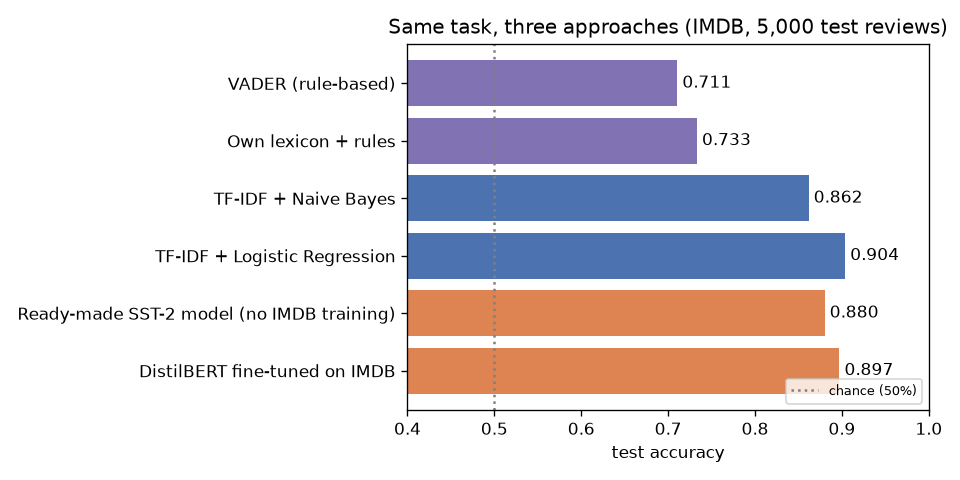
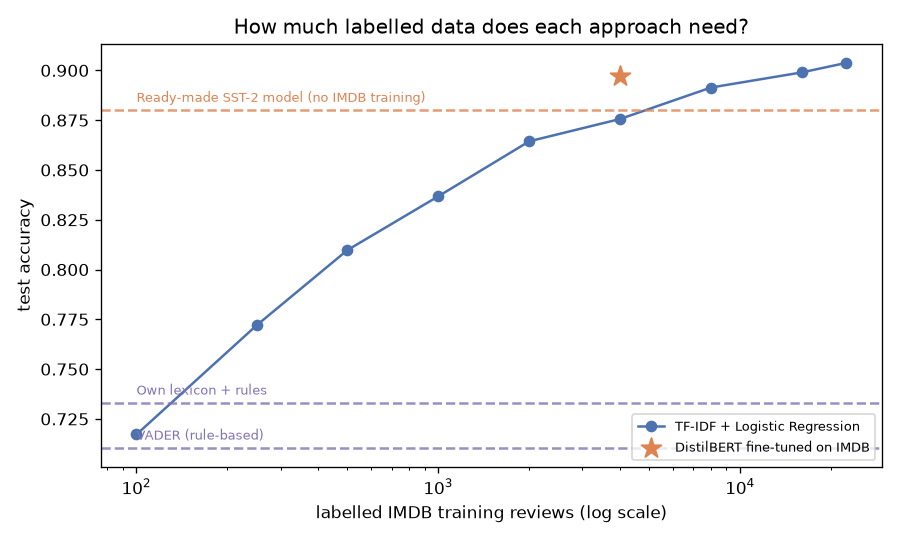

# One Task, Three Approaches: Rules vs. Machine Learning vs. Deep Learning

**Practical NLP series · Chapter 1** — a hands-on companion to Chapter 1 (*"NLP: A Primer"*) of
[*Practical Natural Language Processing*](https://www.oreilly.com/library/view/practical-natural-language/9781492054047/)
(Vajjala, Majumder, Gupta & Surana, O'Reilly 2020).

Chapter 1 explains that NLP problems can be solved with **heuristics**, **classic machine learning** or **deep learning**.
This project solves **one** task, movie-review sentiment classification on the book's **IMDB** dataset, with all three, and compares them on the same test set:
quality, cost, data needs and the kinds of mistakes each one makes.



## Approaches

| Family | Method | Labelled data needed |
|---|---|---|
| Heuristics | Own hand-written lexicon with negation and "but" rules | 0 |
| Heuristics | VADER (NLTK), threshold tuned on the validation set | 0 |
| Machine learning | TF-IDF (unigrams + bigrams) + Multinomial Naive Bayes | 22,500 |
| Machine learning | TF-IDF (unigrams + bigrams) + Logistic Regression | 22,500 |
| Deep learning | DistilBERT fine-tuned with a plain PyTorch training loop | 4,000 on CPU / 22,500 on GPU |
| Deep learning *(domain shift)* | Ready-made DistilBERT fine-tuned on SST-2, not on IMDB | 0 |

**Dataset:** the [IMDB Large Movie Review Dataset](https://ai.stanford.edu/~amaas/data/sentiment/) (Maas et al., 2011), the sentiment dataset used in Chapter 4 of the book, downloaded from the same Stanford link the book uses.
50,000 balanced reviews (25,000 train / 25,000 test). Splits used here: **22,500 train**, **2,500 validation** (10% of the official training set), and a fixed, balanced sample of **5,000 test reviews** shared by all approaches (set `EVAL_TEST_SIZE = None` in `src/utils.py` to use all 25,000).
All hyper-parameters and thresholds are chosen on the validation set; the test set is used only once per model.

## Results

All approaches are evaluated on the same 5,000 IMDB test reviews (CPU run).

| Family | Approach | Labelled IMDB examples | Accuracy | Macro F1 | Training time |
|---|---|---|---|---|---|
| Heuristics | Own lexicon + rules | 0 | 0.733 | 0.721 | – |
| Heuristics | VADER (rule-based) | 0 | 0.711 | 0.708 | – |
| Machine learning | TF-IDF + Naive Bayes | 22,500 | 0.862 | 0.862 | 0.09 s |
| Machine learning | TF-IDF + Logistic Regression | 4,000 | 0.876 | – | ~1 s |
| Machine learning | **TF-IDF + Logistic Regression** | 22,500 | **0.904** | **0.904** | 1.7 s |
| Deep learning | Ready-made SST-2 DistilBERT (no IMDB training) | 0 | 0.880 | 0.880 | – |
| Deep learning | DistilBERT fine-tuned on IMDB | 4,000 | 0.897 | 0.897 | 44.5 min |



### Key findings
- **Rules are a solid start without data, but limited.** The hand-written lexicon (0.733) even beats VADER (0.711) on movie reviews, but both stay far below the learned models.
- **A few hundred labels beat hand-written rules.** Logistic Regression overtakes both rule-based approaches with only 250 labelled reviews, and keeps improving roughly linearly in log(data): 0.717 (100) → 0.876 (4,000) → 0.904 (22,500).
- **With the same data, deep learning wins, at a high cost.** On the same 4,000 reviews, fine-tuned DistilBERT beats Logistic Regression by 2.2 points (0.897 vs. 0.876), but trains about 1,600× longer and predicts about 130× slower on a CPU.
- **More data for the cheap model almost closes the gap.** Logistic Regression on all 22,500 reviews (0.904) is still slightly ahead of DistilBERT on 4,000. DistilBERT reads only the first 256 tokens of each review, while TF-IDF sees the whole text.
- **Transfer learning works across related domains.** A model fine-tuned only on critics' single sentences (SST-2) reaches 0.880 on long IMDB user reviews without a single IMDB label: 15 points above the rules, and only 1.7 points below the fine-tuned model.

**Takeaway, as in Chapter 1:** start with simple baselines, and add complexity only when the gain justifies the cost. Here, TF-IDF + Logistic Regression is the best trade-off between accuracy and cost.

## Notebooks

| Notebook | Content |
|---|---|
| [01_data_exploration](notebooks/01_data_exploration.ipynb) | HTML clean-up, class balance, review lengths, Zipf's law, log-odds of words, why NLP is hard |
| [02_heuristic_approach](notebooks/02_heuristic_approach.ipynb) | Own lexicon with negation/contrast rules, coverage analysis, VADER with a tuned threshold |
| [03_machine_learning_approach](notebooks/03_machine_learning_approach.ipynb) | TF-IDF, Naive Bayes, Logistic Regression, feature weights, single-prediction explanations, learning curve |
| [04_deep_learning_approach](notebooks/04_deep_learning_approach.ipynb) | Sub-word tokenization, truncating long reviews, DistilBERT fine-tuning loop in PyTorch, domain-shift experiment |
| [05_comparison](notebooks/05_comparison.ipynb) | Accuracy, same-data comparison, cost, data needs, agreement matrix and error analysis |

## Project structure

```
practical-nlp-ch01-three-approaches/
├── notebooks/            # the five notebooks, run in order 01 → 05
├── src/
│   └── utils.py          # shared code: IMDB download + splits, tokenizer, evaluation, saving results
├── results/              # metrics (.json) and per-review predictions (.csv), created by the notebooks
├── figures/              # plots used in this README, created by the notebooks
├── requirements.txt
└── README.md
```

## How to run

```bash
# 1. Clone the repository
git clone https://github.com/AT3060/practical-nlp-ch01-three-approaches.git
cd practical-nlp-ch01-three-approaches

# 2. Create and activate a virtual environment
python -m venv .venv
source .venv/Scripts/activate      # Windows (Git Bash)
# source .venv/bin/activate        # Linux / macOS

# 3. Install the dependencies
pip install -r requirements.txt

# 4. Start Jupyter and run the notebooks in order (01 → 05)
jupyter lab
```

The first notebook downloads the IMDB archive (about 84 MB) from Stanford and caches the reviews in `data/` (not committed to Git).

Notebook 04 fine-tunes DistilBERT on 256-token inputs. On a laptop CPU it uses a sample of 4,000 training reviews (very roughly 30–60 minutes); on an NVIDIA GPU it uses all 22,500.
Set `TRAIN_LIMIT = 500` in its configuration cell for a quick test run.

## What I learned

- **Start simple.** Rules need no data and are fully transparent, but their coverage is limited.
- **TF-IDF + Logistic Regression** is a strong, cheap, interpretable baseline that learns domain-specific words automatically.
- **Transformers** understand context and word order better, at a much higher cost in compute and interpretability.
- **Domain shift** matters: a ready-made model trained on critics' single sentences (SST-2) is not automatically as good on long IMDB user reviews.
- **Long texts** force trade-offs for transformers (truncation to 256 tokens), while TF-IDF sees the whole review.

## Tech stack

Python · pandas · scikit-learn · NLTK · PyTorch · Hugging Face Transformers & Datasets · Matplotlib · Jupyter

## Reference

Vajjala, S., Majumder, B., Gupta, A., & Surana, H. (2020). *Practical Natural Language Processing: A Comprehensive Guide to Building Real-World NLP Systems.* O'Reilly Media.
The code in this repository is my own implementation; it is not copied from the book.

## License

[MIT](LICENSE)
